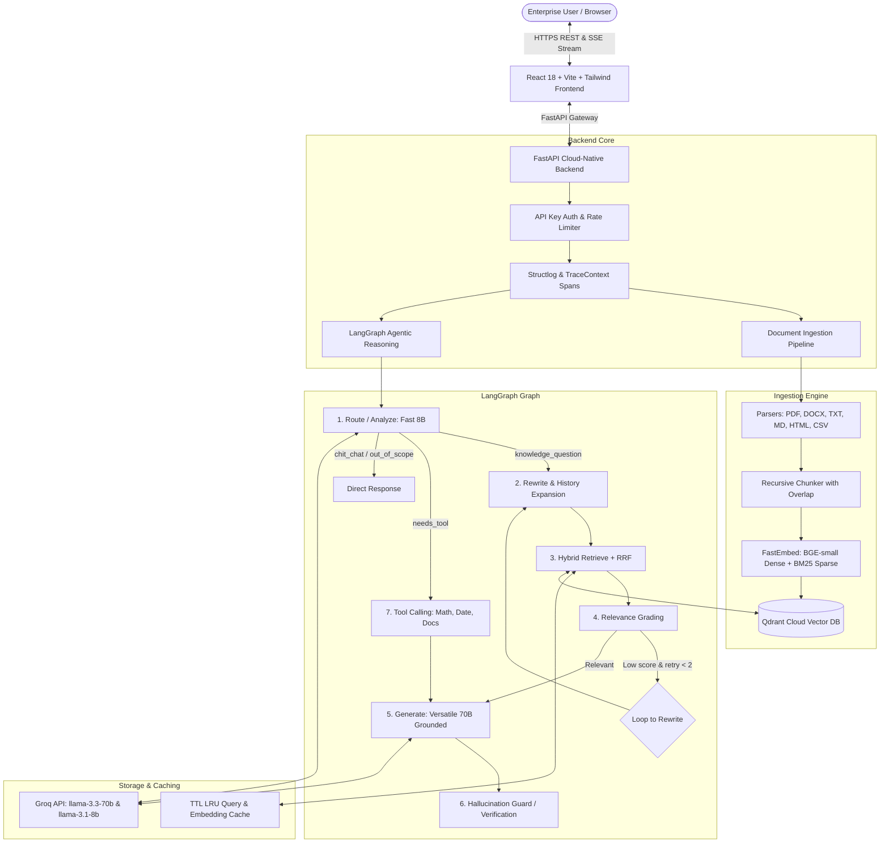
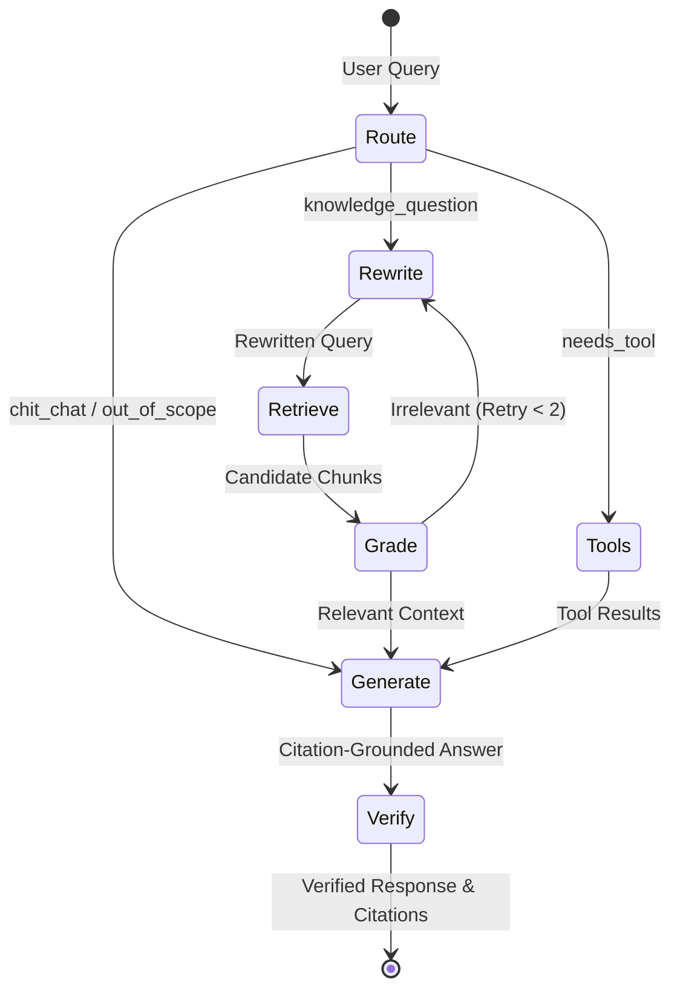

# Enterprise Knowledge AI: System Architecture

## 1. High-Level System Architecture

---

## 2. Ingestion & Vector Indexing Architecture

The document ingestion pipeline processes enterprise documents asynchronously to prevent blocking web worker threads:

1. **Universal Parsing**:
   - **PDF**: Page-by-page extraction preserving page numbering via `pypdf`.
   - **DOCX**: Paragraph and table extraction preserving document hierarchies.
   - **HTML**: Strips scripts, styles, and extracts headers and text using `BeautifulSoup`.
   - **CSV**: Groups rows into structured, readable key-value chunks.
   - **Markdown / Plain Text**: Preserves headers and sectional delineations.

2. **Recursive Hierarchical Chunking**:
   - Recursive character chunker with natural boundaries (`\n\n`, `\n`, `. `, `? `, `! `).
   - Default chunk size: **500 characters** with an overlap of **60 characters**.
   - Preserves metadata: `doc_id`, `filename`, `page_number`, `section_title`, and approximate token counts.

3. **Hybrid Embeddings (Dense + Sparse)**:
   - **Dense Model**: `BAAI/bge-small-en-v1.5` (384-dimensional ONNX model executed locally via `fastembed`). Pre-cached inside the container build to eliminate cold-start delay.
   - **Sparse Model**: `Qdrant/bm25` (term-weight representation for exact token/acronym matching).

4. **Vector Store (Qdrant)**:
   - Cosine distance index for dense vectors with HNSW graph indexing ($M=16, ef\_construct=100$).
   - Named sparse vector index for BM25 term matching.
   - Fast payload indexes on `doc_id`, `source`, `collection`, and `tags` for $O(1)$ filter resolution.

---

## 3. LangGraph Agent Reasoning Workflow

The agent uses a stateful directed graph managed by **LangGraph**:

### Node Specifications:
1. **Route (`route_node`)**:
   - Model: `llama-3.1-8b-instant` (low latency, ~100-200ms).
   - Classifies query into: `knowledge_question`, `chit_chat`, `needs_tool`, `out_of_scope`.
2. **Rewrite (`rewrite_node`)**:
   - Resolves pronouns based on conversation history and expands enterprise domain synonyms.
3. **Retrieve (`retrieve_node`)**:
   - Checks the high-concurrency TTL LRU cache.
   - Performs hybrid search combining dense similarity and sparse BM25 scores via Reciprocal Rank Fusion (RRF with $k=60$).
4. **Grade (`grade_node`)**:
   - Validates that retrieved chunks have sufficient relevance to answer the query.
   - If chunks fail the relevance threshold, loops back to `rewrite` (up to 2 times).
5. **Generate (`generate_node`)**:
   - Model: `llama-3.3-70b-versatile`.
   - Strictly grounded in context. Appends citation brackets `[1]`, `[2]` linking directly to source chunks.
   - Protected by XML delimiter boundaries against prompt injection.
6. **Verify (`verify_node`)**:
   - Hallucination guard: validates every claim against the retrieved context, qualifying or removing unsupported statements.
7. **Tools (`tools_node`)**:
   - Executes function calls: `calculator`, `get_current_datetime`, `list_documents`, `summarize_document`.

---

## 4. Observability & Tracing Architecture

Each node in the LangGraph workflow records an execution span:
- `node`: Node identifier (`route`, `rewrite`, `retrieve`, `grade`, `generate`, `verify`, `tools`).
- `start_time_ms`: Offset from request initiation.
- `duration_ms`: Execution time in milliseconds.
- `status`: `success` or `error`.
- `metadata`: Cache hit/miss, chunk counts, token usage, routing classifications.

All spans are logged as structured JSON via `structlog` and returned in the HTTP response / SSE stream for visual timeline rendering in the frontend.
